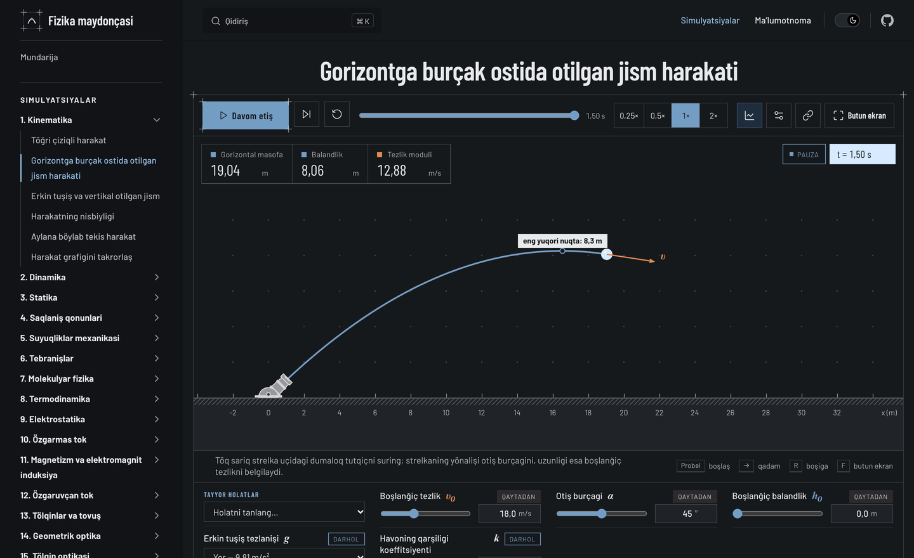
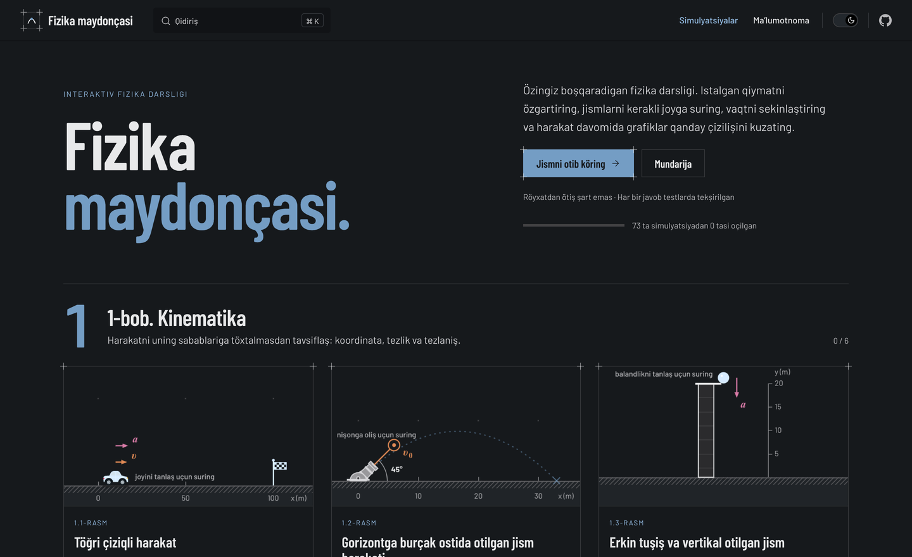

# Fizika maydonçasi

Maktab fizikasi uçun interaktiv darslik: 18 bob, 73 ta simulyatsiya. Qiymatni özgartirasiz, jismni surasiz va natijani şu zahoti körasiz.

**[Saytni oçiş →](https://codeuz-edu.github.io/physics-playground/)**

Bepul, röyxatdan ötiş kerak emas. Kompyuterda ham, telefonda ham işlaydi.



## Saytda nima bor

- **73 ta simulyatsiya.** Har birida parametrlarni özgartiriş va jismlarni siçqonça yoki barmoq bilan suriş mumkin.
- **Vaqtni boşqariş.** Harakatni töxtatiş, qadam-baqadam yuritiş, 0,25 baravargaça sekinlaştiriş yoki 2 baravar tezlaştiriş, istalgan lahzaga qaytiş.
- **Grafiklar va körsatkiçlar.** Harakat davomida grafiklar çiziladi, asosiy kattaliklarning qiymati ekranda körinib turadi.
- **Darslar.** Har bir simulyatsiya ostida asosiy ğoya, nazariya, formulalar va “sinab köring” topşiriqlari bor.
- **219 ta yeçilgan masala.** Har birini bitta tugma bilan simulyatsiyada işga tuşirib, javobini tekşiriş mumkin.
- **Maʼlumotnoma.** Formulalar, fizik doimiylar, ölçov birliklari, maʼlumot jadvallari, atamalar luğati, olimlar va kaşfiyotlar.
- **Qulayliklar.** Sayt böyiça qidiruv, yoruğ va qoronği rejim, simulyatsiyani butun ekranga oçiş, tanlangan qiymatlar bilan havola ulaşiş.

## Boblar



| | | |
|---|---|---|
| 1. Kinematika | 7. Molekulyar fizika | 13. Tölqinlar va tovuş |
| 2. Dinamika | 8. Termodinamika | 14. Geometrik optika |
| 3. Statika | 9. Elektrostatika | 15. Tölqin optikasi |
| 4. Saqlaniş qonunlari | 10. Özgarmas tok | 16. Nisbiylik nazariyasi va kvant fizikasi |
| 5. Suyuqliklar mexanikasi | 11. Magnetizm va elektromagnit induksiya | 17. Atom va yadro fizikasi |
| 6. Tebranişlar | 12. Özgaruvçan tok | 18. Astrofizika |

## Kompyuterda işga tuşiriş

Node.js 22 yoki undan yangi versiyasi kerak.

```sh
npm ci
npm run dev
```

## Litsenziya

[MIT](LICENSE)
